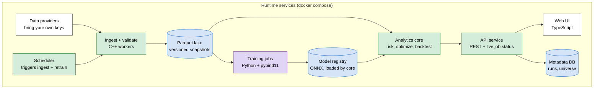
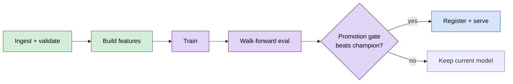

**Note** Made with help from Sonnet 5.5 on 2026/11/16, needs a little rewrite

#### Summary 
> A self-hosted, containerized platform that pulls market data into a local versioned lake, runs risk and portfolio analytics in a C++ core, retrains ML models through a gated pipeline, and serves results through an API and a TypeScript UI. The guiding idea is to **ship the pipeline, not the data**: each user supplies their own provider API keys and builds their own dataset.

## Goals and Scope

- **Coverage target:** major ETFs and public Fortune 100 companies. This is a data-width target rather than a hard requirement; some popular ETFs will not be included.
- **Self-hosting:** `docker compose up` should produce a working instance on a laptop or small server.
- **Easy data and retraining:** one config and one command to ingest new data and retrain models.
- **Language split:** C++ for the core infrastructure, Python for model development, a JS framework (TypeScript) for the frontend.
- **Out of scope initially:** real-time or intraday data, order execution, ETF holdings look-through, multi-node scaling.

#### What "analysis" means 
> "All ETFs and F100" describes the data, not the product. The MVP outputs should be defined explicitly, for example: risk report (volatility, VaR, drawdown), factor exposure, volatility forecast, and a portfolio optimizer (HRP, risk parity).

## Design Principles

1. **Bring your own keys.** Vendors restrict redistribution of their data, and free tiers are typically for personal or internal use. Shipping adapters instead of data avoids the licensing problem and keeps hosting costs at zero.
2. **Use C++ where it earns its place.** The dataset is small (roughly 5,000 symbols over 30 years of daily bars is low single-digit GB uncompressed, much less as Parquet). C++ does not pay off for HTTP routing or glue code. It pays off in dense numerics and simulation loops: Monte Carlo, bootstrap VaR, backtest parameter sweeps, rolling covariance estimation, optimizer solves. It also yields small, fast-starting container images.
3. **Keep storage boring.** Daily batch data on one node needs Parquet files and an embedded query engine, not Kafka or a distributed warehouse.
4. **Reproducibility over cleverness.** Every model is tied to an immutable dataset snapshot, so any result can be regenerated.
5. **One implementation of features.** The same C++ feature code is used in training (through pybind11) and in serving, which prevents training/serving skew.

#### Heuristic for language choice 
> If a component's runtime is dominated by network I/O or waiting, C++ buys almost nothing. If it is dominated by dense numerical work or simulation loops, it buys a lot. Place the language boundary accordingly.

## Architecture Overview

The runtime services form a left-to-right pipeline (providers to UI), with a Python training loop feeding a model registry that the C++ core loads for inference.

Color key: green is the C++ core, purple is Python, blue is storage, white is external or UI.

## Components

### Ingestion

- A **provider adapter** interface (Tiingo, EODHD, FRED, EDGAR, CSV importer) so users plug in whichever source they have a key for.
- Workers are **incremental and idempotent**: a per-symbol watermark records what has been fetched, and re-running a job never duplicates data.
- Pipeline stages: fetch, land raw data unchanged (immutable, timestamped), validate, normalize (splits, dividends, trading calendars), write to the lake.
- Store `ingested_at` next to the data date so you can reconstruct what was known at any point in time.

### Storage

| Layer           | Choice                               | Why                                            |
| --------------- | ------------------------------------ | ---------------------------------------------- |
| Canonical store | Parquet via Apache Arrow             | Columnar, compressed, language-neutral         |
| Query engine    | DuckDB (embeddable, C++ API)         | Analytical SQL with no server to run           |
| Metadata        | SQLite by default, Postgres optional | Universe definitions, job runs, registry index |
| Snapshots       | Manifest plus content hash           | Ties every model to an exact dataset           |

#### Survivorship bias
>  Free sources mostly cover currently listed tickers, so a backtest on today's index members silently excludes failures. Either use ETFs and indices as the universe, or pay for delisted-ticker coverage. Also version the universe by effective date, because the Fortune 100 changes every year. Document the limitation either way.

### Analytics Core (C++ library)

- **Libraries:** Eigen for linear algebra, Arrow for columnar data, a thread pool or oneTBB for parallelism, an existing QP solver (OSQP or Clarabel) for constrained optimization rather than a hand-written one.
- **Modules:** returns and features, covariance estimators (shrinkage, denoising), HRP and risk parity, VaR and expected shortfall, drawdown, backtester with a cost model, Monte Carlo.
- **Exposure:** a library, a gRPC service, and **pybind11** bindings so researchers call the same code the product runs.

### ML Lifecycle

- Train in **Python** (LightGBM, PyTorch, `arch` for GARCH). Run training as an ephemeral container job rather than a permanent service.
- Export to **ONNX** and run inference in C++ through ONNX Runtime. This is the clean bridge between the two languages.
- A small model registry (ONNX file, metrics, dataset snapshot hash) is enough to start. MLflow can be added later as an optional profile.
- Background drift checks compare live inputs and error against the training distribution.

### API Service

- C++ HTTP framework (Drogon, Boost.Beast, or Crow) behind an **OpenAPI spec**.
- Long-running work (backtests, simulations, retrains) is an **async job**: submit, receive a job ID, stream progress over SSE or WebSocket. Never hold an HTTP request open for minutes.

### Frontend

- React or SvelteKit with TypeScript, with the API client generated from the OpenAPI spec so the two sides cannot drift.
- Charts: ECharts or Plotly for analytics, TradingView lightweight-charts for price series. DuckDB-WASM is an optional extra for client-side exploration of Parquet extracts.

### Packaging, Operations, and Testing

- **Compose services:** API, worker, web, and a volume for the lake. The trainer runs as an on-demand profile.
- **Builds:** multi-stage Dockerfiles, vcpkg or Conan for C++ dependencies, **multi-arch images** (amd64 and arm64) since many self-hosters use Apple Silicon.
- **Observability:** Prometheus metrics, structured logs, a health endpoint from day one.
- **Numerical parity tests:** compare C++ outputs against NumPy, SciPy, and `arch` on fixed datasets. This is what makes a C++ financial engine trustworthy.
- **Data-quality tests** on every ingestion run, and ASan/UBSan in CI.

## Retrain Pipeline

One declarative config drives the whole loop. The **promotion gate** is the most important stage: a retrained model only replaces the current one if it beats it on out-of-sample metrics.

## Data Sources

Limits below were checked on 2026-11-16 and change frequently, so verify before relying on them.

|Source|Cost|Notable limits|Best use|
|---|---|---|---|
|Tiingo|Free tier|50 requests/hour, 1,000/day|Equity and ETF prices|
|Massive (formerly Polygon.io)|Stocks Basic free|5 calls/min, end-of-day, 2 years of history|Gap filling|
|Financial Modeling Prep|Free tier|250 requests/day, 5 years of data|Fundamentals|
|EODHD|Free tier, paid from 19.99/month|Free: 20 calls/day, 1 year. Paid: 30+ years, delisted tickers|One-month bulk download|
|FRED|Free|120 requests/min|Rates, spreads, macro|
|Ken French Data Library|Free|CSV downloads|Factor returns|
|SEC EDGAR|Free|Requires descriptive User-Agent|Fundamentals, filings|
|Bank of Canada Valet|Free||Canadian rates and FX|

> [!tip] Cheapest robust setup 
> Use free sources for macro and factors, and spend roughly 20 USD once on a month of EODHD's EOD plan to bulk-download 30+ years of prices including delisted names. Cache everything locally so API limits stop mattering after the first run. Alpha Vantage's free tier (25 requests/day) is too restrictive to be useful here.

## Risks and Open Decisions

- **Scope definition:** pick the MVP analysis outputs before building breadth.
- **Point-in-time universe:** needed to avoid survivorship bias in backtests.
- **ETF holdings look-through:** hard to obtain for free; treat as a later phase.
- **C++ velocity:** dependency management and iteration speed are the usual killers. Keep a fast Python path for experiments.
- **Training/serving skew:** mitigated by one shared feature implementation (pybind11).

## Build Order

Build thin vertical slices rather than finishing each layer before connecting them.

1. **Data layer:** about 30 ETFs end to end, from provider adapter to Parquet snapshot, with validation.
2. **Engine and CLI:** covariance, risk metrics, and HRP, with parity tests.
3. **API and basic UI** showing one real report.
4. **Training pipeline:** volatility forecasting first, with registry and promotion gate.
5. **Scale the universe,** harden, and write docs and the compose setup.

## Sources

- [Tiingo rate limits](https://www.github.com/smartcontractkit/external-adapters-js/blob/main/packages/sources/tiingo/README.md)
- [Massive pricing](https://massive.com/pricing)
- [Massive free plan details](https://veryfront.com/docs/cloud/integrations/polygon.md)
- [Financial Modeling Prep free plan](https://site.financialmodelingprep.com/how-to/how-to-create-a-financial-modeling-prep-account)
- [EODHD plans](https://eodhd.com/help/plans)
- [EODHD pricing](https://eodhd.com/pricing)
- [Alpha Vantage API key and limits](https://www.alphavantage.co/support/api-key)
- [FRED API reference](https://bhanneke.github.io/RISE/skills/hundredx-os/data-fred-api/)
- Whiteboard: https://claude.ai/artifact/AKSoEYz3wq8x3EYNmwWGsF